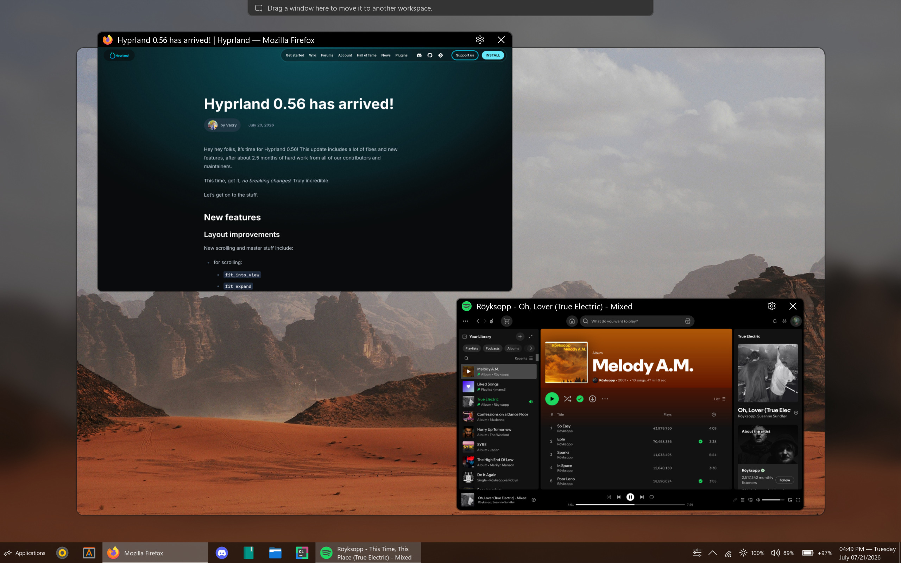

# Mylarplugin

Mylarplugin implements Mylardesktop on Hyprland



## Features

- Animated snap preview
  - Snap groups
  - Snap groups in alt tab menu 
- Physics based spring animations everywhere, like we're living in the 21st century
- Integrated dock
  - wifi control with NetworkManager, or wpa_supplicant
  - audio control with pulseaudio, or alsa
  - bluetooth when bluetoothd running
  - minimize animations
  - brightness control with brightnessctl
  - sleep cpu windows and wake them up for games
  - pin windows to above or below
- Overview mode of windows
- Top workspace preview mover
- Rofi like quick launcher, for applications, or to send text to other programs and accelarete your workflow
- Alt kakoune menu to accelarete your workflow
- Desktop folders
  - Animated selection
- Nightlight
- Mica effect
- Wallpaper engine
- Screenshot tool
  - Edit with, features that sorts most recently used
- Seamless transition into tiling mode (powered by Hyprland)
- Alt tab menu
- Hints for shortcuts
- Screen lock
- Pixel perfect zoom

## Install build dependencies

```bash
sudo pacman -S --needed git gcc make cmake meson cpio pkgconf hyprland \
    librsvg pixman libdrm pango cairo libinput systemd-libs wayland glib2 \
    libxkbcommon dbus alsa-lib libpipewire libpulse gtk3 libxcb xcb-util-wm \
    fontconfig libglvnd
```

## Install with `hyprpm`:

```bash
hyprpm add https://github.com/jmanc3/Mylarplugin
hyprpm enable mylar-desktop
```

To load the plugin automatically when Hyprland starts, add this to ~/.config/hypr/hyprland.lua:

```lua
hl.on("hyprland.start", function()
    hl.exec_cmd("hyprpm reload -n")
end)
```

## Manually building plugin

See [docs/manual-install.md](docs/manual-install.md).
