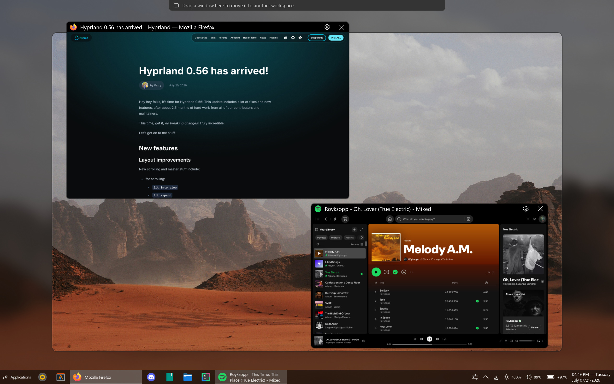

# Mylarplugin

Mylarplugin implements Mylardesktop on Hyprland



## Features

- Animated snap preview
  - Snap groups
  - Snap groups in alt tab menu 
- Physics based spring animations everywhere, like we're living in the 21st century
- Integrated dock
  - wifi control with NetworkManager, or wpa_supplicant
  - audio control with pulseaudio, or alsa
  - bluetooth when bluetoothd running
  - minimize animations
  - brightness control with brightnessctl
  - sleep cpu windows and wake them up for games
  - pin windows to above or below
- Overview mode of windows
- Top workspace preview mover
- Rofi like quick launcher, for applications, or to send text to other programs and accelarete your workflow
- Alt kakoune menu to accelarete your workflow
- Desktop folders
  - Animated selection
- Nightlight
- Mica effect
- Wallpaper engine
- Screenshot tool
  - Edit with, features that sorts most recently used
- Seamless transition into tiling mode (powered by Hyprland)
- Alt tab menu
- Hints for shortcuts
- Screen lock
- Pixel perfect zoom

## Manually building plugin

First install build dependencies

```
sudo pacman -S git gcc cmake make pkg-config pango cairo librsvg libxkbcommon dbus
```

Download latest release.

```
cd Mylarplugin
make release
sudo make install # for resources
```

That will generate `mylar-desktop.so` inside of the `out` folder.

Now you can load the plugin on Hyprland by running `hyprctl plugin load /full/qualified/path/to/mylar-desktop.so`.

To auto start it on login with Hyprland, add the following to `$HOME/.config/hypr/hyprland.lua`

```lua
hl.exec_cmd("sleep 3s; hyprctl plugin load /full/qualified/path/to/mylar-desktop.so")
```
